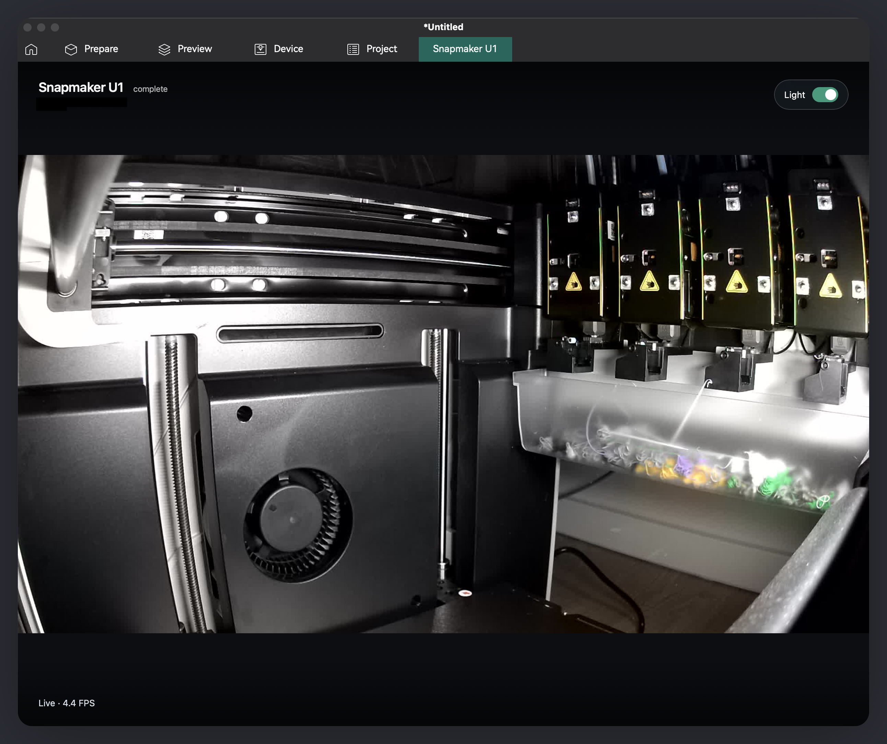

<p align="center">
  
</p>

# orca-snapmaker-u1-camera-plugin

A dedicated Snapmaker U1 tab with a full-viewport camera, printer status, and a chamber light toggle.



## Install

Requires an OrcaSlicer nightly with the Python Pages plugin API and a printer reachable on your local network.
The stock HTTP connection is unencrypted, so use a trusted network.

1. Download `orca-snapmaker-u1-camera-plugin_any.py` from [Releases](https://github.com/lanwen/orca-snapmaker-u1-camera-plugin/releases).
   Older releases omit `_any` from the filename.
2. Open File → Plugins, choose Install local plugin, and select the downloaded file.
3. Activate orca-snapmaker-u1-camera-plugin.
   Orca installs its Python dependencies.
4. Allow the background thread and access to your printer when Orca asks.
5. Select a Snapmaker U1 printer in Prepare, then open the Snapmaker U1 tab.

The plugin asks before using each printer preset's address and API key and remembers your choice for that preset.
You can decline and configure an address manually instead.
If the page asks for an address, open the plugin's Config tab and save:

```json
{"host": "http://YOUR_PRINTER_IP"}
```

This address works regardless of the selected printer preset and overrides its connection settings until you clear it.
For custom ports or printers that require an API key, see [connection configuration](docs/configuration.md#printer-connection).

## Use

Click the play overlay to start the camera.
Hover over the player to reveal Stop.
Keyboard focus and touch also reveal the control.
The light toggle works with playback started or stopped.

Leaving the tab stops playback.
Returning shows the play overlay.
Switching to another app while the tab remains visible keeps playback running.

## Limitations

- The stock camera feed delivers roughly 4–5 FPS.
- Orca cannot hide the tab for other printers.
  Without an explicit plugin host, the plugin requires a U1 preset with an address.
- The light stays in its last state after leaving the page.

## Documentation

- [Connection configuration and updates](docs/configuration.md)
- [Development and local builds](docs/development.md)
- [Release automation](docs/releases.md)
- [Technical behavior and API references](docs/reference.md)

This project uses the [MIT license](LICENSE).
